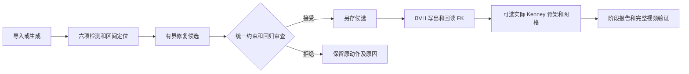

# MotionLint Studio · 0.5.0 参赛候选

面向 AI 生成动作的自动质检、问题定位、有界修复与实际导出回归工具。在现有 HumanAction-Platform 上迭代；保留 InterGen、LODGE 和 Vue 平台，核心可独立安装。



## 独立安装

Python 3.10 / 3.11，Windows / Linux，CPU 核心无需 Docker、生成服务、SMPL-X、Blender 或权重。

```sh
git clone -b feat/import-repair-flow https://github.com/TiAmo0323/AIC.git
cd AIC
python -m pip install -c locks/core.txt .
python -m motionlint.benchmark.fixtures demo
motionlint check demo/clean_00.npy --output-dir reports/clean
motionlint repair demo/foot_sliding_00.npy --output-dir reports/repair
```

建议创建新虚拟环境。工作台和优化配置：

```sh
python -m pip install -c locks/competition.txt ".[competition]"
motionlint serve --port 8004 --data-dir ./motionlint-tasks
motionlint pipeline demo/foot_sliding_00.npy --output-dir products/demo
```

工作台已打包，无需 Node。退出码 0 通过、1 质量失败/回归/比较不完整、2 输入或运行错误。

## 当前能力

- 六项检测：连续性、骨架、脚滑、地面、骨架距离风险、jerk；显示角色、关节、区间、数值及阈值。
- 统一审查新增严重区间、逐脚固定原支撑物理量、骨长、位移和覆盖。
- 修复 v6 增加有界凸优化及双腿 IK，所有候选六项复测；目标物理量改善且分数持平也可接受。
- 完整映射 BVH 脚滑修复，保留层级及非目标通道，写盘后回读。
- 实际 Kenney 骨架、变形网格穿地量和脚底轨迹分别测量，视频完整解码。
- 独立 CLI、离线 HTML、持久化任务、取消、重试、浏览器导入及重导入。

<!-- MOTIONLINT_050_RESULTS_START -->

| 本轮自动证据 | 结果 | 范围 |
| --- | --- | --- |
| 已知缺陷检测 | 宏 F1 1.00；每类 1.00 | 360 可控保留条目 |
| 正常高严重度误报 | 0/36 | 可控正常对照 |
| 脚滑物理改善 | 中位数 100.00% | 54 条预定义可修复保留子集，全部尝试计入 |
| 安全审查 | 60/60 符合拒绝预期 | 专项反例 |
| 真实保留严格通过 | v5 修复 10/36 → v6 修复 22/36 | 同检测规则 v5，无人工准确率真值 |
| 四阶段实际产物 | 6/6 完成；1/6 跨阶段骨架质量通过 | 变形网格指标另列，不纳入骨架质量门 |
| 本机测试与安装 | 229 通过，10 可选跳过；4 种 wheel 配置通过 | Windows Python 3.10/3.11 核心与优化 |

完整数据见 [本轮结果](docs/MOTIONLINT_050_RESULTS.md) 和 [机器记录](evidence/iteration-050-results.json)。

<!-- MOTIONLINT_050_RESULTS_END -->

## 可复现证据与边界

[使用说明](docs/MOTIONLINT_QUICKSTART.md) · [迁移](docs/MOTIONLINT_MIGRATION_V5.md) · [迭代记录](docs/MOTIONLINT_050_ITERATION.md) · [来源清单](THIRD_PARTY_NOTICES.md) · [权利审核](docs/MOTIONLINT_RELEASE_REVIEW.md)

默认规则 v5、修复 v6、报告格式 v3，旧规则和历史结果保留。可控集指标仅代表注入测试；真实输入无人工缺陷或语义真值，不声称真实动作检测准确率。
脚滑单步 0.15m、累计 0.20m；无法修复、资源不足及阶段质量失败如实保留。

这是用户授权的开发与参赛审阅候选，未发布 PyPI，未给整体项目自动指定 MIT。遗留代码与团队权属待确认；模型、受限数据、SMPL-X、FBX 及未确认授权资产不进核心包。
本轮无人工标注、访谈或同学安装记录；AI 辅助开发和材料生成按实际情况披露。

## 验证与维护

```sh
python -m pip install -c locks/competition.txt ".[web,test,optimize,build]"
python -m pytest -q
python scripts/ci_wheel_matrix.py
```

CI 验证 Windows / Linux × Python 3.10 / 3.11 的核心和优化 wheel 仓库外安装，保存浏览器操作记录。代码冻结后修改检测/修复需新保留测试版本。新问题请附最小输入、FPS、单位、映射及报告，勿上传受限资源或凭据。

[GitHub Actions](https://github.com/TiAmo0323/AIC/actions) · [官方赛事要求](https://www.aicomp.cn/tracks/tracks-5/4924.html)
